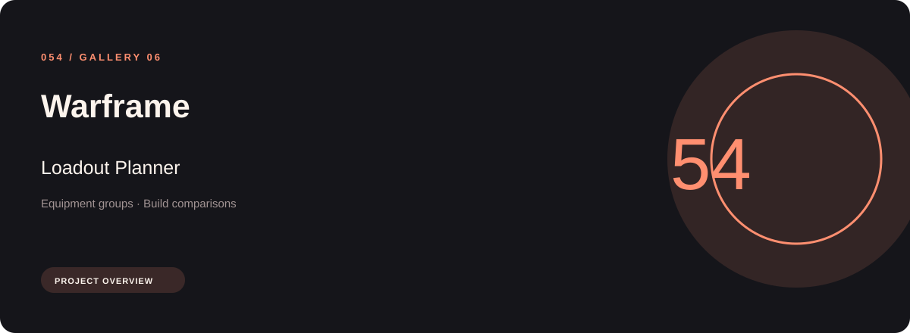
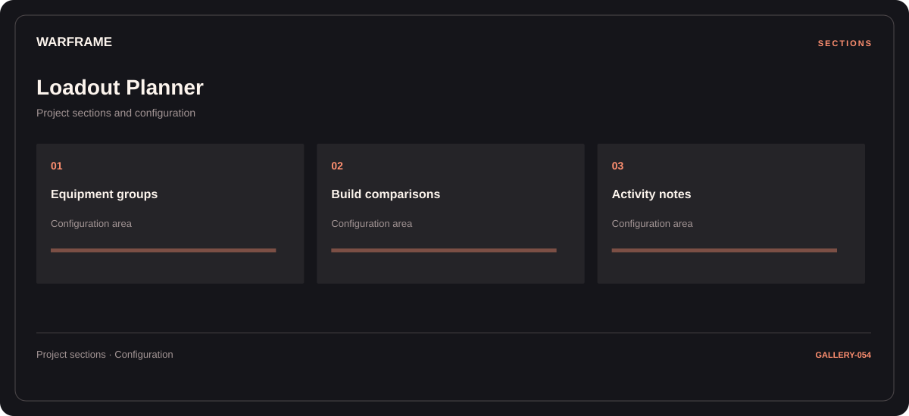

# ⚡ Warframe Loadout Planner

**Equipment groups · Build comparisons · Activity notes**

## ⚡ Features

A loadout planner workspace for Warframe, built around equipment groups and build comparisons, with activity notes kept in a separate reference area.

### ⚙️ Equipment groups

Equipment categories and the associated selection or configuration options.

### 🧩 Build comparisons

A dedicated section for build comparisons and the configuration details associated with that area.

### ⌨️ Activity notes

Session and activity information grouped by the task or context it belongs to.

## 🖥️ Project navigation

## 📥 Download

The button and cover open the project's download page. Use the information supplied with the downloaded package for installation and release-specific requirements.

## 📚 Project documentation

- [Feature reference](docs/FEATURES.md)
- [Download information](docs/DOWNLOAD.md)
- [Project page](index.html)

---

Warframe Loadout Planner · Program documentation and download information.
